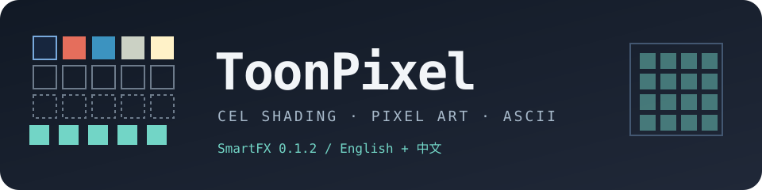

# ToonPixel SmartFX



**English** | [简体中文](README.zh-CN.md)

**v0.1.2** · Native C++ effect for After Effects · English / 中文界面

ToonPixel turns Beauty/RGB and Alpha into cel-shaded bands, pixel-art palettes, dithering, contour coverage and an optional ASCII raster. It is a **RGB approximation**, not a 3D renderer and not a normal/depth/material G-buffer reconstruction.

## Download v0.1.2

Get the platform attachments and hashes from **[GitHub Release v0.1.2](https://github.com/luoboruodai/toolpixel/releases/tag/v0.1.2)**. GitHub's automatic *Source code* archives are for source review, not the installer downloads.

| Platform | Attachment | Verified scope |
|---|---|---|
| macOS 11+ | `ToonPixel-v0.1.2-macOS-universal.zip` | Universal `arm64` + `x86_64` bundle; AE 26.5 on Apple Silicon: 99/99 output cases and bilingual UI passed. Intel is built but not host-tested. |
| Windows x64 | `ToonPixel-v0.1.2-Windows-x64.zip` | Cross-built PE `.aex`; exports, imports, PiPL and VERSIONINFO checked. **Windows AE loading and rendering have not been host-tested.** |
| Checksums | `SHA256SUMS.txt` | Hash each downloaded ZIP before extracting. |

**Windows preview:** test on a disposable project first. Do not infer production compatibility from a successful cross-build. Windows on Arm, other AE versions, GPU rendering, 8/16 bpc and full color management are outside the current verification scope.

## Install

- [macOS installation / macOS 安装](docs/INSTALL-MACOS.md)
- [Windows installation / Windows 安装](docs/INSTALL-WINDOWS.md)

Quit AE completely and back up your project before replacing a plug-in. Remove only older **ToonPixel** copies from the active MediaCore directory, leaving unrelated effects untouched. Restart AE and add **ToonPixel SmartFX** from the **ToonPixel** category.

The macOS bundle is ad-hoc signed, **not notarized**. The Windows binary has **no Authenticode signature**. No Developer ID or commercial-code-signing claim is made.

## What is included

- **Cel shading:** Preserve Hue or five-band Luma Ramp with four boundaries, five color stops, softness and repeat. `Toon Only`, `Pixel Only`, or combined output.
- **Pixel treatment:** Original 8, Style 10, or 1–10 custom colors; 4×4 / 8×8 Bayer and Floyd–Steinberg dithering with threshold and spatial decay.
- **Color:** Oklch tint wheel, exposure, vibrance, hue, chroma, and Oklab gamut mapping.
- **Contours:** Luma-gradient or Alpha/background coverage with 1× / 2× / 4× antialiasing.
- **ASCII / RXXR:** Fourteen character/graphic styles, editable character ramp, Luma/Map/Audio drivers, color, flicker, glitch and chromatic aberration.
- **Language / 语言:** English by default. Parameter names and custom Ramp, Oklch and ASCII captions switch to Chinese; native popup items remain bilingual.

### Parameter and scripting compatibility

The language parameter was appended at index **97**; older parameter indices and default English behavior are unchanged. There are **98 native parameters including the implicit input**. ExtendScript also exposes a host-provided **Compositing Options** property at index 98.

Use `effect.property("Language / 语言")` or `effect.property(97)` to change language. While Chinese is active, an English-name lookup such as `effect.property("Mode")` fails; use the numeric parameter index or restore English. Do not use `effect.property(effect.numProperties)` to find Language.

## Verified, not assumed

- **macOS:** Debug / Release / AddressSanitizer: each 4/4 CTest checks passed. AE 26.5x89 on Apple Silicon: bilingual round-trip and **99/99 real output cases**, including the Ramp color contract, passed in 32 bpc, non-color-managed CPU SmartFX with `MFR=OFF`.
- **Windows:** MinGW-w64 cross-compilation produced a real x64 PE DLL exporting `EffectMain`. Static checks cover dependencies, the exact-case `PiPL` resource, native version `0.1.2 release 1`, and Windows file version `0.1.2.1`. The feature-smoke executable was also cross-compiled, not executed on Windows.
- **Not covered:** continuous-drag/host-idle verification, real Windows AE, other AE versions, Intel host testing, GPU/Classic rendering, 8/16 bpc, full color management, and Windows on Arm.

See [compatibility and verification](docs/COMPATIBILITY.md), [release notes](docs/RELEASE_NOTES-v0.1.2.md), and [changelog](CHANGELOG.md).

## Build from source

The Adobe SDK is **not bundled**. Set `AE_SDK_ROOT` to an SDK you are licensed to use. Do not copy proprietary Adobe headers into this repository.

```bash
# macOS: CMake, a C++17 compiler, Rez and codesign
AE_SDK_ROOT=/path/to/AfterEffectsSDK ./build.sh

# Windows x64 cross-build from macOS/Linux: MinGW-w64
AE_SDK_ROOT=/path/to/AfterEffectsSDK ./build_win.sh

# Package already-built binaries and offline installation guides
python3 tools/package_release.py --commit YOUR_REVIEWED_COMMIT
```

See [build instructions](docs/BUILDING.md). No Python runtime is required by the installed effects. Public source excludes the old test bridge, private AE projects, logs, reference plug-ins and private media.

## Notices

[License](LICENSE.md) · [Notice](NOTICE.md) · [Third-party notices](THIRD_PARTY_NOTICES.md) · [Publishing status](PUBLISHING_STATUS.md)
