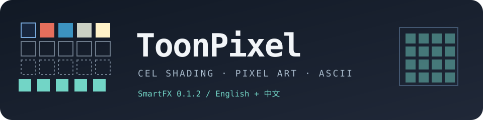

# ToonPixel SmartFX



[English](README.md) | **简体中文**

**v0.1.2** · After Effects 原生 C++ 效果 · English / 中文界面

ToonPixel 将 Beauty/RGB 与 Alpha 转换为三渲二色带、像素色板、抖动、轮廓覆盖以及可选的 ASCII 字符栅格。它是 **RGB 近似效果**，不是三维渲染器，也不接入法线、深度或材质 G-buffer，不会恢复真实三维几何。

## 下载 v0.1.2

前往 **[GitHub Release v0.1.2](https://github.com/luoboruodai/toolpixel/releases/tag/v0.1.2)** 下载对应平台的安装附件和校验值。GitHub 自动生成的 *Source code* 压缩包用于审查源码，不是安装附件。

| 平台 | 附件 | 实际验证范围 |
|---|---|---|
| macOS 11+ | `ToonPixel-v0.1.2-macOS-universal.zip` | 含 `arm64` 与 `x86_64`；Apple Silicon 的 AE 26.5 已通过 99/99 真实输出与中英文界面验证。Intel 仅完成编译，未实机验证。 |
| Windows x64 | `ToonPixel-v0.1.2-Windows-x64.zip` | 已生成 PE `.aex`，核验导出、依赖、PiPL 和 VERSIONINFO。**尚未在 Windows AE 中实测加载与渲染。** |
| 校验文件 | `SHA256SUMS.txt` | 解压前先核对下载 ZIP 的 SHA-256。 |

**Windows 预发布说明：**请先在可丢弃的测试工程中验证。交叉编译成功不代表生产环境兼容。Windows on Arm、其他 AE 版本、GPU、8/16 bpc 和完整色彩管理均不在当前验证范围内。

## 安装

- [macOS 安装 / macOS installation](docs/INSTALL-MACOS.md)
- [Windows 安装 / Windows installation](docs/INSTALL-WINDOWS.md)

替换插件前请完全退出 AE 并备份工程。只清理当前 MediaCore 目录中的旧 **ToonPixel** 文件，不要改动其他无关效果。重新启动 AE，在 **ToonPixel** 分类中添加 **ToonPixel SmartFX**。

macOS 包仅有 ad-hoc 签名，**未经公证**；Windows 文件**没有 Authenticode 签名**。不宣称 Developer ID 或商业签名。

## 功能

- **三渲二：**保留色相或使用五档亮度色带，含四个边界、五个色标、柔化与重复；支持仅卡通、仅像素和组合输出。
- **像素风：**Original 8、Style 10 或 1–10 个自定义颜色；4×4 / 8×8 Bayer 与 Floyd–Steinberg 抖动，支持阈值和空间衰减。
- **调色：**Oklch 色轮、曝光、鲜艳度、色相、彩度和 Oklab 色域映射。
- **轮廓：**亮度梯度或 Alpha/背景覆盖，提供 1× / 2× / 4× 抗锯齿。
- **ASCII / RXXR：**14 种字符/图形样式、可编辑字符序列、Luma/Map/Audio 驱动、颜色、闪烁、故障和色差。
- **Language / 语言：**默认英文；参数名和 Ramp、Oklch、ASCII 自绘文字可切换中文，原生菜单项保持双语。

### 参数与脚本兼容性

语言参数追加在索引 **97**，旧参数索引和默认英文行为不变。含隐式输入共 **98 项原生参数**。ExtendScript 还会在索引 98 暴露宿主提供的“合成选项”。

通过 `effect.property("Language / 语言")` 或 `effect.property(97)` 切换语言。中文模式下 `effect.property("Mode")` 等旧英文名称查询会失败，应使用参数索引或切回英文。不要用 `effect.property(effect.numProperties)` 查找语言参数。

## 验证而非推定

- **macOS：**Debug / Release / AddressSanitizer 各 4/4 回归通过。Apple Silicon 的 AE 26.5x89 中完成中英文往返，**99/99 真实输出**及 Ramp 色彩契约通过；环境为 32 bpc、非色彩管理、CPU SmartFX、`MFR=OFF`。
- **Windows：**MinGW-w64 已生成真实 x64 PE DLL，导出 `EffectMain`。静态核验依赖、精确大小写的 `PiPL` 资源、原生版本 `0.1.2 release 1` 和 Windows 文件版本 `0.1.2.1`。测试程序已交叉编译，但未在 Windows 执行。
- **尚未覆盖：**连续拖动与宿主 idle、真实 Windows AE、其他 AE 版本、Intel 实机、GPU/Classic、8/16 bpc、完整色彩管理和 Windows on Arm。

详见[兼容性与验证](docs/COMPATIBILITY.md)、[发布说明](docs/RELEASE_NOTES-v0.1.2.md)和[更新记录](CHANGELOG.md)。

## 从源码构建

仓库**不包含 Adobe SDK**。请将 `AE_SDK_ROOT` 指向你有权使用的 SDK，不要把 Adobe 专有头文件复制进本仓库。

```bash
# macOS：CMake、C++17 编译器、Rez 和 codesign
AE_SDK_ROOT=/path/to/AfterEffectsSDK ./build.sh

# 从 macOS/Linux 交叉构建 Windows x64：MinGW-w64
AE_SDK_ROOT=/path/to/AfterEffectsSDK ./build_win.sh

# 对已构建的二进制与离线安装指南打包
python3 tools/package_release.py --commit 已审核的提交
```

详见[构建说明](docs/BUILDING.md)。安装后的插件不依赖 Python。公开源码不包含旧测试桥、私有 AE 工程、日志、参考插件或私有媒体。

## 声明

[许可](LICENSE.md) · [声明](NOTICE.md) · [第三方声明](THIRD_PARTY_NOTICES.md) · [发布状态](PUBLISHING_STATUS.md)
